# Automated Zero-Downtime Deployment for Last-Mile Tracking

A personal DevOps portfolio project demonstrating automated testing,
container publishing, Kubernetes deployment, GitOps validation,
monitoring and measured availability during rolling pod replacement.

The API uses fictional, read-only delivery data. It is not Petrocom's
application or infrastructure and is not a production service.

## Verified result

The API was deployed to Amazon EKS in London (`eu-west-2`) with
two healthy replicas across two worker nodes.

An in-cluster requester sent delivery lookup requests during a rolling
restart:

```text
RESULT successful_requests=238 failed_requests=0
```

The requester was checked as active when the rollout completed.

This demonstrates no failed sampled requests during this specific
rolling restart. The test used the existing application image.
It does not prove uninterrupted availability between samples, validate
a new application release or guarantee zero downtime for future changes.

The temporary EKS cluster was deleted after testing.

## Technology stack

- Python standard-library HTTP API and unit tests
- Docker and GitHub Container Registry
- GitHub Actions
- Kubernetes Deployments, Services and Jobs
- Argo CD, validated in a temporary kind cluster
- Prometheus, Grafana and Alertmanager, validated in temporary CI environments
- Amazon EKS, EC2, VPC and IAM
- eksctl and AWS CloudFormation for AWS infrastructure

Terraform is not used in this repository's EKS deployment.

## Deployment architecture

This project separates the manual AWS EKS exercise from the GitOps and
monitoring tests performed in temporary CI environments.

### Image publishing and EKS deployment

GitHub Actions tests and builds the application image, which is published
to GitHub Container Registry.

AWS infrastructure is created separately using eksctl and CloudFormation.
The operator deploys the application to EKS using kubectl and the
Kubernetes manifests. GitHub Actions does not automatically deploy to EKS.

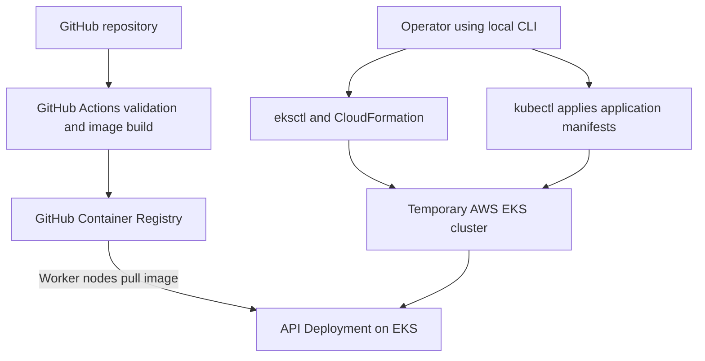

### EKS rolling-restart availability test

A Kubernetes Job sends delivery lookup requests through the ClusterIP
Service while the Deployment replaces its pods.

The tested deployment had two healthy API replicas observed across two
worker nodes. No public application load balancer was created.

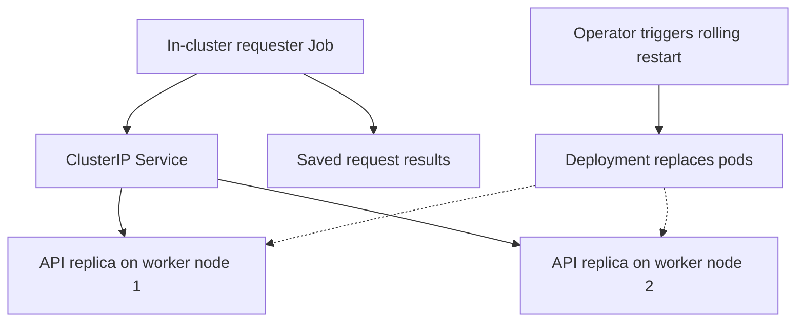

The requester was checked as active when the rollout completed.

```text
RESULT successful_requests=238 failed_requests=0
```

This demonstrates no failed sampled requests during this specific rolling
restart of the existing application image. It does not establish
uninterrupted availability between samples, validate a new application
release or guarantee zero downtime for future changes.

The temporary EKS environment was deleted after testing.

### Separate CI validation environments

Argo CD synchronization and application health are tested in a temporary
kind cluster. Prometheus, Grafana and Alertmanager are validated in
temporary CI environments.

These components were not installed on the EKS lab. The diagrams below
show separate test relationships, not one shared persistent environment.

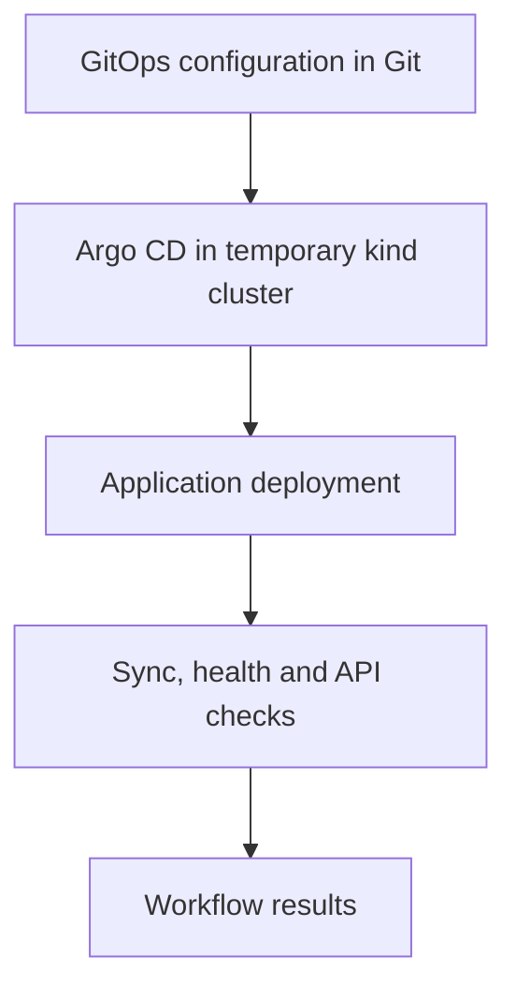

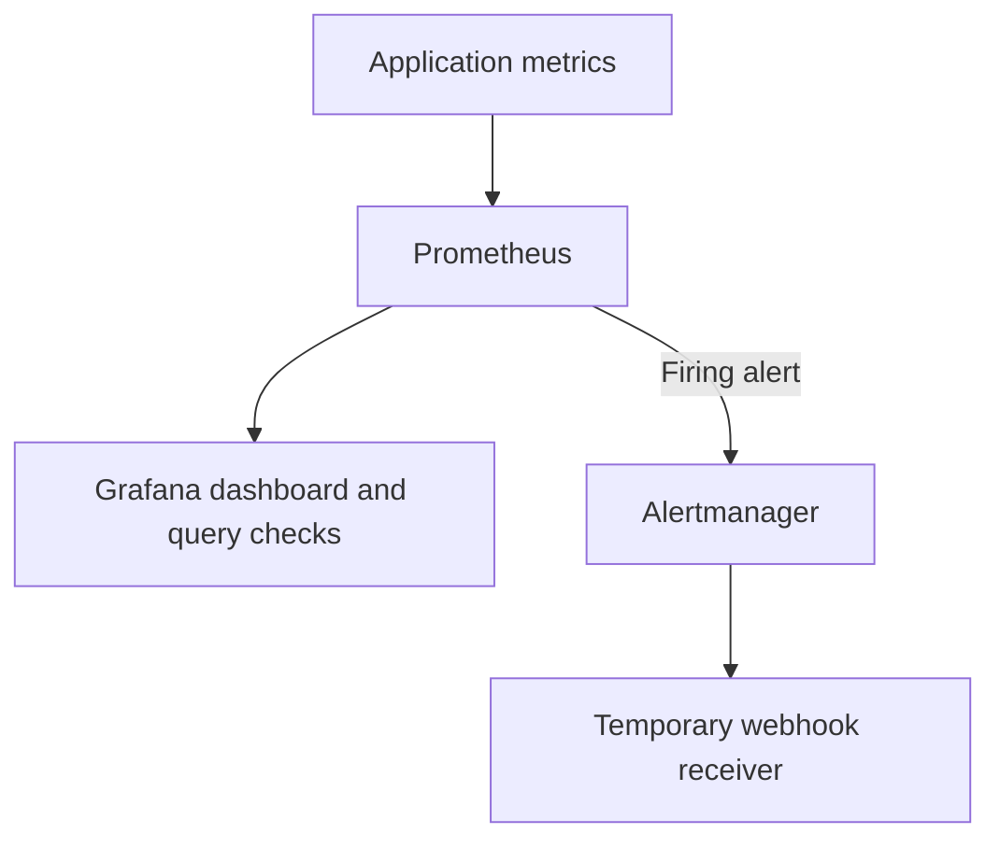

Monitoring tests verify metric collection, dashboard queries,
DeliveryAPIDown firing and recovery, and delivery of a firing notification
to the test webhook.

Slack, email and resolved-notification delivery are outside the tested
notification scope.

## Run locally

Use Python 3.12 or a compatible version.

```powershell
python -m unittest discover -s tests -v
python -m app.server
```

In another PowerShell window:

```powershell
Invoke-RestMethod http://localhost:8080/healthz
Invoke-RestMethod http://localhost:8080/readyz
Invoke-RestMethod http://localhost:8080/deliveries/DEL-1001
```

Stop the server with Ctrl+C. To use another port, set
`$env:PORT = "8081"` before starting it.

## Run with Docker

Requires a working Docker installation.

```powershell
docker build -t last-mile-api:local .
docker run --rm -p 8080:8080 last-mile-api:local
```

Docker Desktop is not required for the GitHub Actions tests because
Docker runs on the hosted runner.

## Kubernetes deployment settings

The API Deployment uses:

- Two replicas
- RollingUpdate with `maxUnavailable: 0` and `maxSurge: 1`
- Readiness and liveness probes
- CPU and memory requests and limits
- A non-root container with a read-only root filesystem
- Disabled privilege escalation and dropped Linux capabilities

The Service uses ClusterIP. No public application load balancer was
created for the EKS exercise.

These settings support availability during pod replacement, but runtime
tests are still required to measure actual behavior.

## Automated validation

| Workflow | Purpose |
|---|---|
| `test-argocd.yml` | Argo CD synchronization, health and deployed API checks |
| `test-grafana.yml` | Dashboard provisioning, metric queries and screenshot capture |
| `test-alerting.yml` | API-down alert firing and recovery |
| `test-alert-notification.yml` | Alertmanager firing-alert webhook delivery |
| `test-rollout-availability.yml` | Sampled availability during pod replacement in kind |

The repository also includes API testing, image build/publishing,
Kubernetes validation and image security scanning.

See the [GitHub Actions history](https://github.com/niks6996/last-mile-devops-pipeline/actions)
for run results.

The kind rollout test uses the same image under two different tags.
The EKS test uses a rolling restart of the existing image.

## Monitoring and alerting

Prometheus collects application metrics. Grafana provisions a Prometheus
data source and a two-panel dashboard:

- API request rate
- Cumulative requests grouped by route and HTTP status


Automated tests verify that:

- Grafana can query application metrics through Prometheus.
- DeliveryAPIDown fires when the API is unavailable.
- The alert clears when the API recovers.
- A firing notification reaches a temporary webhook through
  Prometheus -> Alertmanager -> receiver.

Slack and email notification delivery are not configured. The webhook
test verifies a firing notification, not a resolved notification.

## AWS EKS practical exercise

| Item | Tested configuration |
|---|---|
| Region | London, `eu-west-2` |
| Kubernetes version | 1.36 |
| Cluster | `lastmile-lab` |
| Managed node group | `api-workers` |
| Worker instances | Two `t3.small` instances |
| Operating system | Amazon Linux 2023 |
| Node storage | 20 GiB gp3 per node |
| Networking | Public worker subnets; NAT Gateway disabled |
| API endpoint | Public and private access enabled |
| Application replicas | Two, observed across separate worker nodes |
| Request test | Delivery lookup through the in-cluster Service |
| Result | 238 successful requests, 0 failed |
| Lifecycle | Temporary cluster created, tested and deleted after validation |

Infrastructure configuration: [eks/cluster.yaml](eks/cluster.yaml)

Availability test: [eks/availability-job.yaml](eks/availability-job.yaml)

Saved test output: [availability-result.txt](docs/evidence/eks/availability-result.txt)

### Deployment evidence

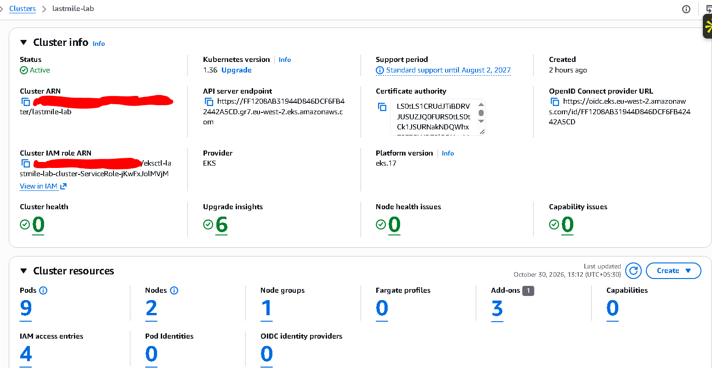

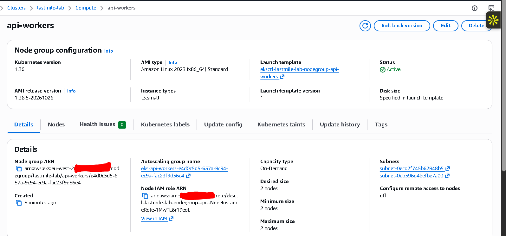

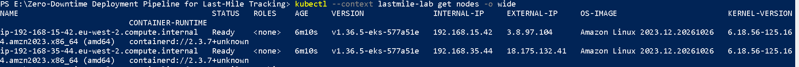

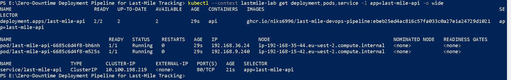

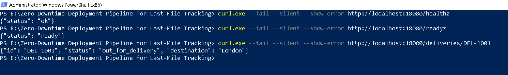

### Rollout evidence

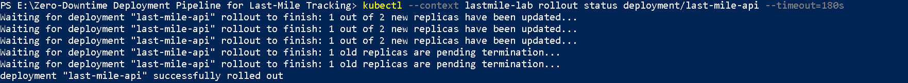

[Requester-active check](docs/images/10b-requester-active-check.png)

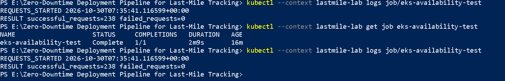

### Cleanup evidence

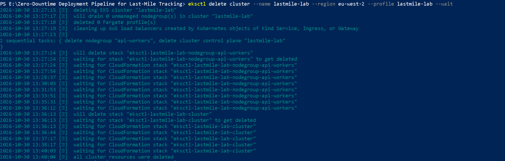

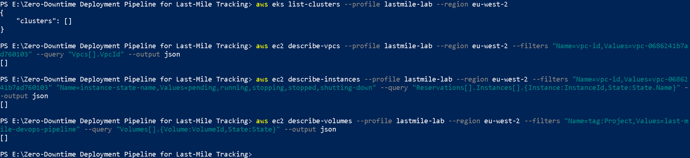

Post-deletion checks covered the EKS cluster list, the project VPC,
non-terminated instances in that VPC and project-tagged EBS volumes.
The EBS query does not prove the absence of untagged volumes or unrelated
AWS resources.

## Troubleshooting demonstrated

### EKS node-group launch failure

The initial `t3.medium` node group failed because AWS rejected that
instance type as ineligible under the account's Free Tier restrictions.

The failure was identified from CloudFormation events. After checking
eligible types and zone offerings, the failed node-group stack was
deleted and recreated with `t3.small`, preserving the control plane.

Termination protection on the failed stack had to be disabled before
deletion.

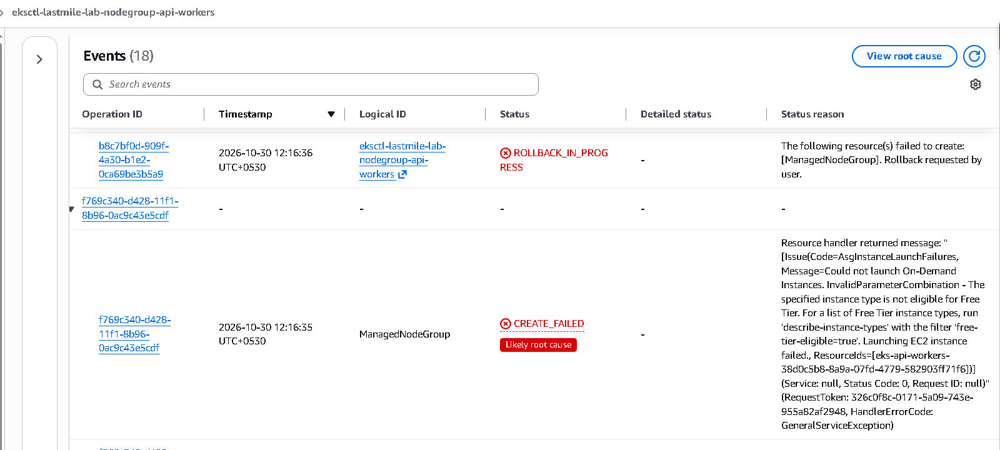

Free Tier eligibility does not guarantee that the complete EKS
deployment is free.

### Argo CD Redis image pull

An Argo CD CI test failed when Amazon ECR Public returned
`429 Too Many Requests` while pulling Redis. Switching the test's Redis
image source to Docker Hub allowed the subsequent test to pass.

### Grafana query retries

A Grafana metric query returned an HTTP error. The retry loop was
updated so transient curl failures do not immediately terminate the
step, with response output retained for diagnosis. A subsequent run passed.

## Reproduce the EKS exercise

AWS resources incur charges. Review the configuration, IAM permissions,
instance eligibility, support status and current pricing first.

Required tools: AWS CLI, compatible kubectl and eksctl.

```powershell
aws login --profile lastmile-lab --region eu-west-2

$env:AWS_PROFILE = "lastmile-lab"
$env:AWS_REGION = "eu-west-2"

eksctl create cluster --config-file .\eks\cluster.yaml --dry-run
eksctl create cluster --config-file .\eks\cluster.yaml --profile lastmile-lab

aws eks update-kubeconfig --name lastmile-lab --profile lastmile-lab --region eu-west-2 --alias lastmile-lab

kubectl --context lastmile-lab apply -f .\k8s\deployment.yaml
kubectl --context lastmile-lab apply -f .\k8s\service.yaml
kubectl --context lastmile-lab rollout status deployment/last-mile-api --timeout=180s
```

Use `eks/availability-job.yaml` to start the requester. Verify its
`REQUESTS_STARTED` log before triggering a rolling restart. Check that
the requester remains active when the rollout completes, then inspect
the Job outcome and request counts.

Do not use a local port-forward as the rollout test traffic path:
it can disconnect when its selected pod is replaced.

Delete the lab after testing:

```powershell
eksctl delete cluster --name lastmile-lab --region eu-west-2 --profile lastmile-lab --wait
```

Verify cleanup independently after deletion. Investigate failed
CloudFormation stacks rather than repeatedly running creation commands.

## Security and scope

- Fictional sample data only.
- No AWS credentials or kubeconfig files should be committed.
- AWS login used a dedicated IAM user with MFA and temporary CLI sessions.
- Some lab permissions, including EC2 management in London, are broad.
  This setup does not provide strict project isolation or a
  production-grade least-privilege IAM design.
- Public worker subnets and public Kubernetes API access are lab choices.
- There is no persistent production deployment.
- No claim is made that GitHub Actions automatically deployed to EKS:
  the AWS exercise used local CLI commands.
- New-release deployment, automatic rollback and production load testing
  remain future improvements.
