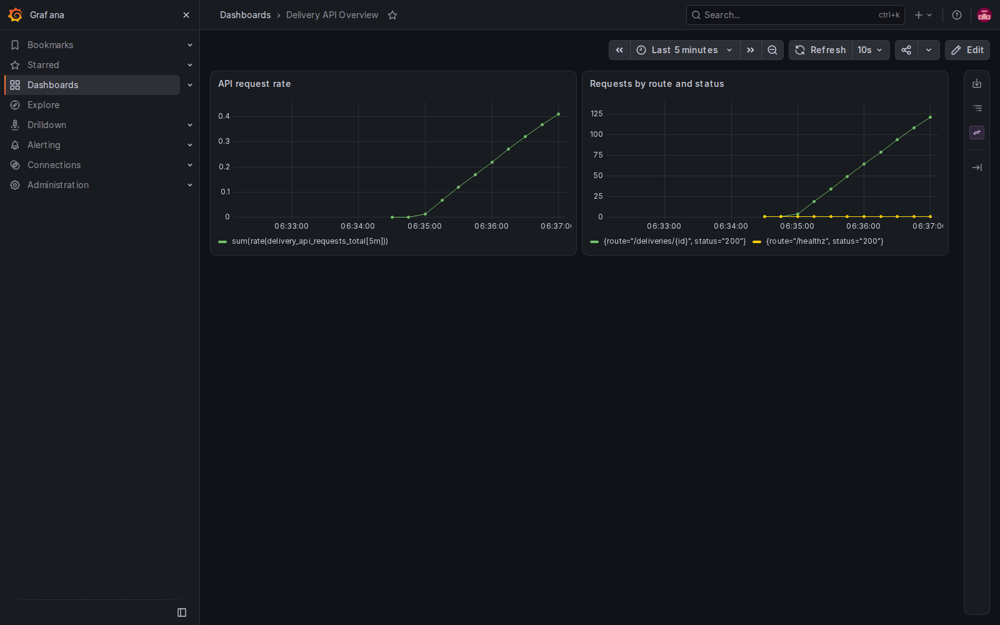

# Last-Mile DevOps Portfolio: Stage 1

A fictional, read-only delivery tracking API built as a personal portfolio demonstration inspired by logistics. It contains sample data only and is not Petrocom's application or infrastructure.

## What works now

Python standard-library HTTP API, automated API tests, a non-root container image and a GitHub Actions workflow to run tests and build the image. No external packages are needed. The API stores two fixed example records in memory and is not a production service.

| GET endpoint | Purpose |
| --- | --- |
| `/healthz` | Liveness response |
| `/readyz` | Readiness response (no external dependencies yet) |
| `/deliveries` | List fictional deliveries |
| `/deliveries/DEL-1001` | Get one delivery; unknown IDs return 404 |

## Run locally (Python 3.12)

From this folder:

```powershell
python -m unittest discover -s tests -v
python -m app.server
```

In a second PowerShell window:

```powershell
Invoke-RestMethod http://localhost:8080/healthz
Invoke-RestMethod http://localhost:8080/deliveries
Invoke-RestMethod http://localhost:8080/deliveries/DEL-1001
```

Stop the server with Ctrl+C. Set `$env:PORT = "8081"` before starting it if port 8080 is occupied.

## Run with Docker

With Docker Desktop running:

```powershell
docker build -t last-mile-api:local .
docker run --rm -p 8080:8080 last-mile-api:local
```

Test with the same PowerShell requests above, then stop with Ctrl+C.

## Planned next stages

1. Add Kubernetes manifests with resource limits, health probes and a service.
2. Add image security scanning and publishing, then GitOps deployment and rollout/rollback tests.
3. Integrate with the existing EKS platform after reviewing its current configuration and cost implications.
4. Add application metrics, dashboards and tested alerts.

These are plans, not completed features. Do not claim zero downtime until it has been measured during a rollout. No AWS resources are created by this stage.


## Monitoring and deployment validation

The project uses GitHub Actions to test the delivery API and its
supporting deployment and monitoring configuration in temporary
environments.

### Kubernetes and GitOps tests

- Deploy the API into a temporary kind Kubernetes cluster.
- Verify Argo CD reports the application as Synced and Healthy.
- Test the deployed API through its Kubernetes Service.
- Send repeated health-check requests during a rolling update.
- Fail the availability test if any sampled request fails.

The rollout test uses the same application image with two different
tags. It validates pod replacement and sampled availability during
that exercise. It does not validate an application code change or
guarantee zero downtime for future releases.

### Monitoring tests

- Verify that Prometheus scrapes application metrics.
- Provision a Grafana Prometheus data source and two-panel dashboard.
- Verify application metrics through Grafana's data source API.
- Capture the rendered dashboard as a GitHub Actions artifact.
- Verify that DeliveryAPIDown fires when the API is unavailable.
- Verify that the alert clears after the API recovers.
- Verify firing-alert notification delivery through
  Prometheus → Alertmanager → a temporary webhook receiver.

The notification test validates delivery to the test webhook.
Delivery to an operational Slack or email destination has not
been configured.

### Grafana dashboard



The dashboard shows:

- API request rate calculated from the application request counter.
- Cumulative request counts grouped by route and HTTP status.

### Test workflows

| Workflow file | Purpose |
|---|---|
| `.github/workflows/test-argocd.yml` | Argo CD sync, health and deployed API checks |
| `.github/workflows/test-grafana.yml` | Grafana provisioning, metric queries and dashboard screenshot |
| `.github/workflows/test-alerting.yml` | API-down alert firing and recovery |
| `.github/workflows/test-alert-notification.yml` | Alertmanager firing-alert webhook delivery |
| `.github/workflows/test-rollout-availability.yml` | Sampled API availability during Kubernetes pod replacement |

Workflow runs and logs are available in the
[GitHub Actions history](https://github.com/niks6996/last-mile-devops-pipeline/actions).

### Troubleshooting example

An Argo CD test failed because its Redis image could not be pulled.
Pod events showed that Amazon ECR Public returned
`429 Too Many Requests` with `Data limit exceeded`.

The test workflow was updated to pull the Redis image from Docker Hub.
The subsequent Argo CD test passed.

### Current scope and remaining work

Kubernetes and Argo CD tests run in temporary kind clusters.
Monitoring tests use temporary containers or clusters in GitHub Actions.
These environments are removed when the workflows finish.

AWS EKS integration remains pending. The current results demonstrate
automated test-environment validation, rather than a persistent
production deployment.